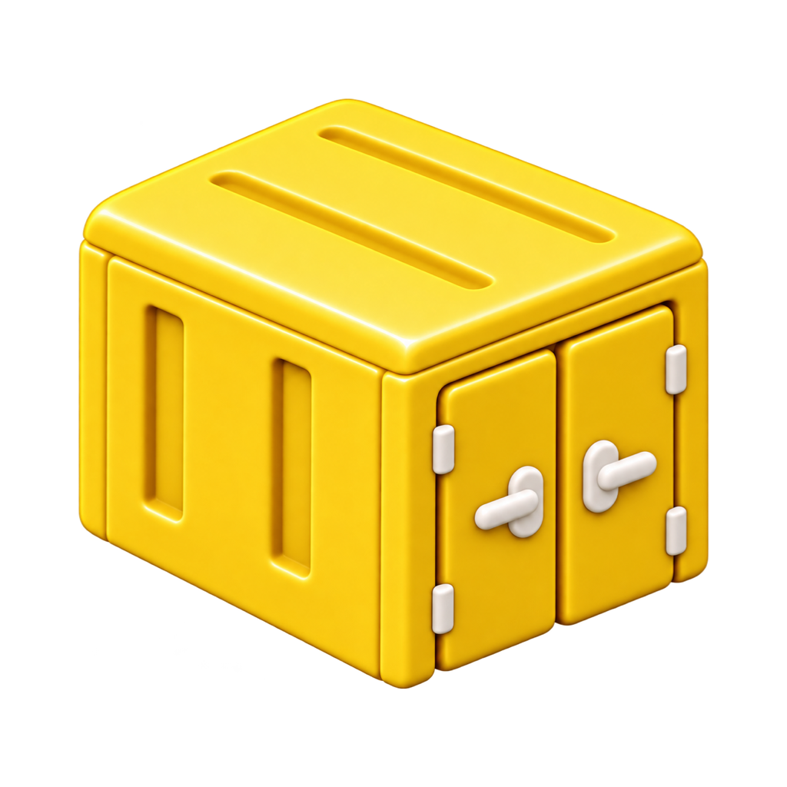
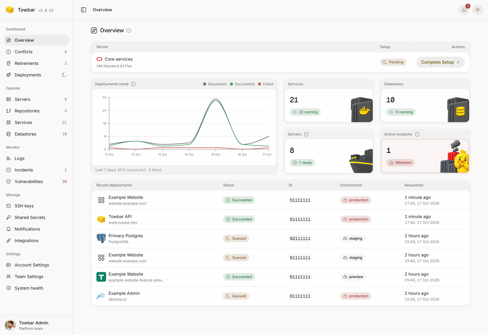

<p align="center">
  <a href="https://www.towbar.dev">
    
  </a>
</p>

<h1 align="center">Towbar</h1>

<p align="center"><strong>Open-source, Git-native PaaS</strong></p>
<p align="center">Deploy anything to servers you own, defined via Git repositories.<br />Previews, monitoring, and batteries included.</p>

<p align="center">
  <a href="https://www.towbar.dev">Website</a> ·
  <a href="https://www.towbar.dev/docs">Documentation</a> ·
  <a href="https://www.towbar.dev/blog/introducing-towbar">Introducing Towbar</a> ·
  <a href="https://github.com/avgeek-oss/towbar/issues">Issues</a>
</p>

<p align="center">
  <picture>
    <source media="(prefers-color-scheme: dark)" srcset="docs/assets/release-v2/overview-dark.png" />
    
  </picture>
</p>

Towbar lets you deploy Services and managed Datastores to servers you own.
Connect a Git repository, describe what should run, and manage it from one
dashboard.

Towbar is self-hosted. Its control plane, deployment servers and optional
external log storage run on infrastructure you manage.

## What's included

| Area          | What you get                                                                                               |
| ------------- | ---------------------------------------------------------------------------------------------------------- |
| Services      | Deploy from a Dockerfile, static site, buildpack, container image, or Docker Compose file                  |
| Datastores    | PostgreSQL, MySQL, MariaDB, MongoDB, Redis, Dragonfly, KeyDB, and ClickHouse                               |
| Git workflows | GitHub and GitLab connections, branch-based environments, automatic deployments, and pull-request previews |
| Domains       | Custom domains and automatic HTTPS                                                                         |
| Operations    | Logs, server and container monitoring, alerts, incidents, scheduled jobs, and vulnerability scans          |
| Backups       | Scheduled backups, restores, retention rules, and common cloud-storage destinations                        |
| Team access   | Admin, Member, and Viewer roles, invitations, passkeys, sessions, API keys, and audit history              |
| Automation    | REST API keys and OAuth-authorized MCP access for HTTPS installations                                      |

## Install Towbar

Run Towbar on a dedicated Ubuntu or Debian server. The installer asks whether
you want a local-only setup or public HTTPS dashboard and API domains. If you
choose public domains, point both DNS A records to the server first.

Run the installer:

```bash
curl -fsSL https://github.com/avgeek-oss/towbar/releases/latest/download/install.sh | sudo bash
```

The installer prepares the server, downloads Towbar, creates the required
configuration, and starts it. When it finishes, open the URL it prints, create
your Admin account, connect GitHub or GitLab, and add a deployment server.

Read [Install Towbar](https://www.towbar.dev/docs/self-hosting/installation) for
server requirements, DNS, HTTPS, configuration, and recovery. The
[CLI guide](https://www.towbar.dev/docs/self-hosting/cli) lists every available
command.

> [!NOTE]
> REST API, MCP, and API-key management are available only on HTTPS
> installations. A localhost-only installation exposes the dashboard on the
> Towbar host and keeps those interfaces disabled.

## Declare a repository

Towbar reads a root `towbar.yml` and entity files under `.towbar/services/`
and `.towbar/datastores/`. Compose manifests also belong in `.towbar/services/`.

```yaml
# towbar.yml
version: 2
environments:
  production: {}
  staging:
    previews:
      enabled: true
```

Map each environment to a branch in Towbar. Every sync reads one immutable
revision and applies the validated inventory atomically. Manifest files contain
the required secret names. Store values in Towbar or a configured secrets provider.

Removing a manifest preserves its workload for retirement review. A compatible
manifest can transfer management to another repository while keeping its identity,
secrets, volumes and deployment history. See
[Conflicts and retirements](https://www.towbar.dev/docs/repositories/conflicts-and-retirements).

Start with the [example configuration](examples/) or follow
[Your first deployment](https://www.towbar.dev/docs/getting-started). The
[deployment manifest](https://www.towbar.dev/docs/deployment-manifest) documents
the complete schema with focused examples.

## Architecture

The control plane runs as a Docker Compose stack:

- the **dashboard** presents deployment and operational state;
- the **API** owns validation, authorization, persistence, REST, MCP, and
  real-time transports;
- the **worker** executes durable Temporal workflows;
- **PostgreSQL** stores control-plane state;
- **Temporal** coordinates deployments and long-running operations; and
- the optional **Caddy gateway** provides separate dashboard and API HTTPS
  origins with automatic TLS.

Target servers run the workloads Towbar manages. Scout Agent is opt-in and
reports server and container measurements. The native OTEL collector sends
container logs through the API to external ClickHouse when log storage is configured.

Read the [architecture guide](https://www.towbar.dev/docs/architecture) for the
service boundaries, repository layout, data model, workflow path, security
model, and direct links into the implementation.

## Documentation

- **[Introduction](https://www.towbar.dev/docs)**: concepts, architecture,
  installation, CLI, first deployment, and migration guides.
- **[Build & run](https://www.towbar.dev/docs/services)**: repositories,
  servers, Services, Datastores, releases, previews, domains, secrets, and manifests.
- **[Datastores](https://www.towbar.dev/docs/datastores)**: supported engines,
  configuration, health checks, backups, and restores.
- **[Operate](https://www.towbar.dev/docs/monitoring)**: Scout Agent,
  performance, alerts, incidents, vulnerability scanning, troubleshooting, and
  workspace access.
- **[Integrations](https://www.towbar.dev/docs/integrations)**: source control,
  registries, backup destinations, external secrets, platform services,
  and notifications.
- **[API & MCP](https://www.towbar.dev/docs/api)**: authentication, endpoints,
  MCP tools, and automation workflows.

For an existing workload, use the migration guide for
[Coolify](https://www.towbar.dev/docs/migrate-from-coolify),
[Dokploy](https://www.towbar.dev/docs/migrate-from-dokploy),
[CapRover](https://www.towbar.dev/docs/migrate-from-caprover),
[Dokku](https://www.towbar.dev/docs/migrate-from-dokku),
[Heroku](https://www.towbar.dev/docs/migrate-from-heroku),
[Railway](https://www.towbar.dev/docs/migrate-from-railway),
[Render](https://www.towbar.dev/docs/migrate-from-render), or
[Vercel](https://www.towbar.dev/docs/migrate-from-vercel).

## Feedback and issues

Avgeek OSS does not accept public contributions, to curb automated pull
requests and because no dedicated resources are available to review and sign
them off. Bug reports, feature requests and other feedback are welcome:
[open an issue](https://github.com/avgeek-oss/towbar/issues), and we triage it
and strive to fix it at the earliest. Report vulnerabilities privately through
[SECURITY.md](SECURITY.md). The maintainers' local setup and required checks are
in [CONTRIBUTING.md](CONTRIBUTING.md).

Towbar uses Node.js 26, pnpm 11, and Turborepo. Release history is recorded in
[CHANGELOG.md](CHANGELOG.md).

## License

[Apache License 2.0](LICENSE). Created by **Avgeek, Inc.** and maintained by
[Praveen Thirumurugan](https://github.com/praveentcom).
