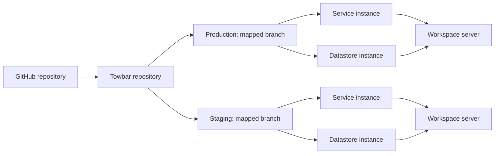

Towbar connects the configuration in Git to the services running on your servers. The dashboard records what you asked it to deploy, what ran, and what is healthy now.

## The objects you work with

| Concept          | What it represents                                                  | Where you configure it                                   |
| ---------------- | ------------------------------------------------------------------- | -------------------------------------------------------- |
| Team / workspace | The boundary for members, servers, shared secrets, and integrations | Towbar                                                   |
| Repository       | A connected GitHub repository or GitLab project                     | Towbar                                                   |
| Environment      | A named deployment target, such as production or staging            | Declare in `towbar.yml`; map its branch in Towbar        |
| Server           | One Ubuntu host identified by its IP address                        | Towbar                                                   |
| Service          | A source build, prebuilt OCI image, or Compose workload             | `.towbar/services/**/*.service.yml` or `*.compose.yml`   |
| Datastore        | A managed database or cache engine                                  | `.towbar/datastores/**/*.datastore.yml`                  |
| Instance         | A Service or Datastore in one connected environment                 | Shared entity settings plus environment overrides        |
| Deployment       | One attempt to build or pull, start, check, and promote an instance | Queued manually or by policy                             |
| Release          | A retained result identifying the deployed image and configuration  | Recorded by Towbar                                       |
| Preview          | A Service instance associated with a pull request                   | Enable for the target environment and opt in per service |

A server can run instances from several Repositories and environments. Register the physical host once, then reference its IP address in entity files. Production and staging can use different servers or share a host while keeping separate containers, volumes, and secret values.

## Configuration has three homes

**Git describes the workload.** The root file declares environments. Entity files define images or Dockerfiles, health checks, domains, resource limits, required secret keys, and deployment policy. Keep stable IDs when renaming a service or datastore so its history stays attached. IDs must be unique within a workspace and environment, including across repositories. See [ownership and retirement](/docs/repositories/conflicts-and-retirements) before moving or removing a manifest.

**Towbar stores workspace state and workload secrets.** Environment-to-branch mappings, SSH credentials and trust, concurrency, and encrypted workload secret values belong in Towbar. Saving a secret does not deploy it.

**The host configuration controls Towbar and its integrations.** Database credentials, public origins, internal authentication, provider credentials, and notification routes live in `/etc/towbar/config.yml` on the control-plane host. The dashboard lists only integrations whose complete configuration passed startup validation. GitHub installations and GitLab OAuth grants remain workspace state because they are created by provider authorization flows.

## A sync is different from a deployment

An environment sync reads one immutable commit from its mapped branch, validates the complete configuration, and updates its instances atomically. Invalid configuration leaves the previous instances and secret slots intact. It may queue automatic deployments when policy permits. A successful sync means the configuration was accepted; check the deployment separately to know whether it went live.

A deployment records an immutable configuration snapshot. Secret values are resolved when execution starts. Health observations describe the running container and can change after a successful deployment.

## Production, staging, and previews

Map production to `main` and staging to `develop`, for example, in Repository environment settings. Each environment reads its configuration from its own branch. Changing a mapping syncs configuration without automatically deploying or replacing the environment’s identity and data.

Previews run eligible same-repository pull requests targeting the branch mapped to a preview-enabled environment, with Service opt-in also required. Preview secrets are isolated from the target environment’s persistent secrets. PR configuration does not change persistent instances or their required-secret slots, and previews do not clone Datastores.

Continue with the [architecture](/docs/architecture) to trace these concepts through the open-source code, or follow [Your first deployment](/docs/getting-started) to use them.
