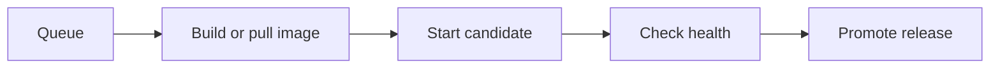

import { Screenshot } from "/snippets/oss/screenshot.jsx";

List filters and page positions are kept in the URL. Bookmark a deployment-history page or use browser Back to return to it. Notification deliveries, vulnerability lists, lifecycle lists, and other paginated resource histories also preserve their position. Changing a filter starts at the first page.

A deployment is one attempt to put a service or datastore into service. Towbar records its trigger, immutable inputs, progress, duration, and final result separately from Repository sync history.

<Screenshot
  light="/assets/release-v2/deployments-light.jpg"
  dark="/assets/release-v2/deployments-dark.jpg"
  alt="Deployment history shows each workload's logo or icon, type, environment, and status."
  width="3200"
  height="1800"
  caption="Find a deployment by workload, environment, status, or trigger."
/>

## Browse deployment history

Use the Deployments page sidebar to filter by workload type, environment, status, trigger, or server. Sort by request time or workload name. Filters and sorting apply to the full history before pagination, and the URL preserves your selection.

The **Service / Datastore** column shows the workload's logo or icon with its type below the name, such as Container image, Redis, or PostgreSQL. Open a row to inspect its recorded inputs and stages.

On mobile, open **Page menu** to access the filters.

For a Service with Preview enabled in its connected environment, use the selector beside **Deployments** to switch between that environment's deployments and **Previews**. The selection and page are preserved in the URL.

Failed or cancelled attempts have a **Retry** action in history and deployment details. A retry records a new attempt; the original logs and result remain available. Preview retries revalidate the pull request and deploy its latest eligible revision using Preview configuration and secrets.

## Deploy manually

Open a service or datastore and choose **Deploy**. The server must be prepared and trusted, and required credentials must be configured. Follow the queued operation through its recorded stages; a queued request is not a completed deployment.



The details vary by workload and configured hooks. Use the operation's actual stage output when diagnosing a failure.

## Resource limits during rolling deployments

Container CPU limits cap usage; they do not reserve cores. The combined CPU limits of workloads on a server can exceed its CPU count. When workloads are busy at the same time, they share the available CPU capacity. Towbar keeps each container’s CPU limit in place without blocking deployment based on the sum of those limits.

Before starting rolling candidates, Towbar checks available host memory against the memory limits of the additional containers. Candidate health checks must still pass before promotion.

## Automatic deployments

Services and datastores are manual unless `autoDeploy` is enabled. `autoDeploy: true` treats commits as deployment inputs. Services can narrow their inputs with repository globs:

```yaml title=".towbar/services/web.service.yml" highlight={2-6}
id: web
autoDeploy:
  inputs:
    - package.json
    - pnpm-lock.yaml
    - apps/web/**
environments:
  production: {}
```

This is a fragment, not a complete manifest. Towbar compares selected file identities and configuration to decide whether to queue work. An incomplete Git tree is treated as changed. Include every file that can affect the built service, including shared libraries and build configuration.

Use the Repository's pause controls to stop automatic deployment during maintenance. Saving a secret does not enqueue a deployment; deploy explicitly when you want the new value to take effect.

## Deployment hooks

Service hooks run commands around deployment. Add hook configuration under the service:

```yaml title=".towbar/services/web.service.yml"
hooks:
  preDeploy:
    command: ["node", "scripts/migrate.js"]
    timeoutSeconds: 120
  postDeploy:
    command: ["node", "scripts/warm-cache.js"]
    timeoutSeconds: 60
```

A pre-deploy failure stops deployment before promotion. A post-deploy failure is reported as a warning after promotion. Hooks receive their own stage-specific secrets. Design commands so retries are safe and schema changes remain compatible with the previous release.

## Read the final result

| Result                  | Meaning                                                            |
| ----------------------- | ------------------------------------------------------------------ |
| Succeeded               | Deployment completed successfully                                  |
| Succeeded with warnings | The release was promoted, but a later step needs attention         |
| Failed                  | A required stage failed; inspect the last stage and active release |
| Cancelled               | The operation stopped through cancellation                         |

Durations advance while work is ongoing and stop at the final timestamp. The latest runtime health can still change after deployment succeeds.

## Inspect image vulnerabilities

For opted-in services, open **Vulnerabilities** in the deployment’s secondary sidebar to inspect the immutable image’s scan state, severity totals, and package findings. **Monitor → Vulnerabilities** collects findings across the workspace. A successful deployment can still have vulnerabilities; a scan failure does not change deployment health. See [Vulnerability scanning](/docs/vulnerability-scanning) for setup and result interpretation.

## Roll back an image

Use a retained release when you need to return to a previous image. Rollback uses current runtime secrets, so it does not restore revoked credentials. It also does not undo database writes or schema migrations. Check compatibility before rolling back a service that ran a migration.

Database recovery is a separate [restore operation](/docs/restores). For build or startup failures, follow [Troubleshooting](/docs/troubleshooting).
