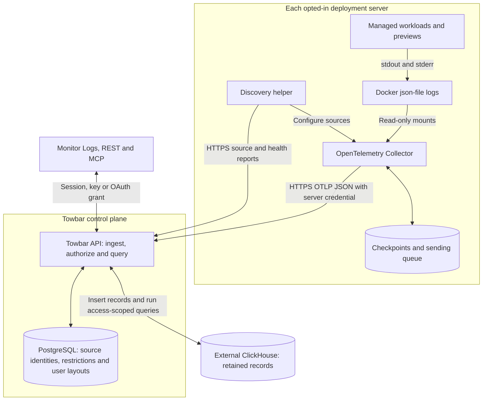

Centralized logs retains stdout and stderr from managed Services, Datastores,
Compose services, and previews. Open workspace **Monitor → Logs** to search across
servers and deployments. The collector runs separately from Scout; enabling or
disabling it does not change performance measurements.

The feature is optional. Without a ClickHouse connection, the Logs page explains
how to connect one. Workload **Monitor → Runtime Logs** still retrieves current
container output on demand, including when centralized logging is unavailable.
Deployment and build logs remain in their existing views.

## Architecture

Each opted-in server runs a discovery helper and an OpenTelemetry Collector.
The helper reports managed container identities and configures file readers. Log
records travel over HTTPS to the Towbar API before reaching ClickHouse.



PostgreSQL keeps control-plane metadata and each user's latest table layout.
ClickHouse stores the retained records and answers searches and chart queries.
Towbar checks the current role, connection permissions, workload restrictions and
retention cutoff for each read. Browsers and collectors have no direct ClickHouse
access; its credentials stay in the operator configuration on the control plane.

The administrator enables or updates a collector through Towbar's durable worker
workflow. The worker connects over SSH with verified host keys. Once installed,
the collector reads files and sends records independently of that SSH session.
Runtime Logs remains a separate, on-demand path to current container output.

## Connect external ClickHouse

Towbar does not provision or manage the logging database. Supply an existing
ClickHouse HTTP endpoint, including the port when necessary. The endpoint must be
an origin without a path, query, or embedded credentials. Use HTTPS with a trusted
certificate whenever the database connection crosses a network.

An operator creates a dedicated database and account. For example, run these
statements as a ClickHouse administrator, replacing the password:

```sql
CREATE DATABASE towbar_logs;
CREATE USER towbar_logs IDENTIFIED WITH sha256_password BY 'replace-with-a-strong-password';
GRANT SELECT, INSERT, CREATE TABLE, ALTER ON towbar_logs.* TO towbar_logs;
```

The account needs table creation for the initial schema, inserts and reads for
collection and queries, and ALTER for schema maintenance. Towbar creates its own
`log_records` table in this database. Use a separate database rather than pointing
Towbar at an application database with unrelated tables. Grant access only from
the Towbar API host; collectors never receive ClickHouse credentials.

Edit the root-owned `/etc/towbar/config.yml`:

```yaml title="/etc/towbar/config.yml"
observability:
  logs:
    retentionDays: 7
    clickhouse:
      endpoint: https://clickhouse.example.com:8443
      database: towbar_logs
      username: towbar_logs
      password: "replace-with-a-strong-password"
```

Keep the file readable only by root. Do not commit credentials to a deployment
manifest or put them in a browser configuration form. Apply the configuration:

```bash
sudo towbar config validate
sudo towbar restart
sudo towbar doctor
```

The Logs page checks connection, authentication, table access, and the required
privileges. An unavailable database shows a sanitized reason and a link to this
guide. An administrator can also run `towbar_logs_verify` through MCP to check an
expiring verification insert and read. A healthy database check alone does not
prove that any server is collecting logs.

## Enable a server collector

1. Prepare the server and allow Docker host log collection in its server settings.
2. Open the server's Scout settings and find **Centralized logs**.
3. Choose **Enable collection**. Towbar queues installation over the server's
   configured SSH connection using its trusted host keys.
4. Inspect the status, supported container count, backlog, and last accepted
   record. **Waiting** means setup completed without an accepted log record yet;
   it is not proof of ingestion.

Towbar installs a systemd discovery helper and a pinned OpenTelemetry Collector
container. The helper uses the host's Docker CLI to identify managed containers.
The collector receives read-only mounts for Docker log files, a private local
checkpoint/queue directory, and a revocable credential scoped to this server. It
has no Docker socket and no ClickHouse credential. It needs outbound HTTPS access
to the Towbar API. Installation supports Ubuntu servers on amd64 and arm64.

The collector uses the image version and digest shipped with Towbar. **Update
collector** installs that pinned version; it does not select an arbitrary upstream
image. The helper is limited to 96 MiB and 5% of one CPU, and the collector to
256 MiB and 0.25 CPU.

### Coverage and delivery limits

- Collection supports Docker's `json-file` logging driver. Containers using other
  drivers are counted as unsupported. Changing a container's driver requires
  recreating it; enabling collection does not silently change workload settings.
- Existing containers start at the end when collection is first enabled. New
  containers start at the beginning. Checkpoints resume reads after a collector
  restart, while files remain available.
- Production and preview containers are both eligible. Towbar resolves their
  workload, deployment, environment, and access policy before accepting records.
- Each server is limited to 512 discovered containers, 64 MiB of ingestion per
  minute, and a 512 MiB logical persistent sending queue. Queue files have storage
  overhead. The helper reports physical queue usage and pauses readers when that
  usage exceeds the queue budget, allowing the exporter to drain it.
- The collector retries temporary API/storage failures. Accepted replays are
  deduplicated by Docker record identity, while repeated messages at different
  positions remain separate records. Records older than 24 hours are rejected
  during recovery, or earlier if retention has expired.
- Before managed container removal, cleanup attempts to confirm the final stopped
  container record with the API. The attempt has an eight-second budget; a failed
  confirmation is recorded in cleanup output and does not block deployment or
  cleanup indefinitely. Accepted records remain available independently of the
  source container.
- This is bounded collection, not an archive guarantee. Docker rotation,
  container removal, a full disk, or an outage beyond the queue/recovery window
  can lose records that Towbar has not accepted. Already accepted records survive
  redeployment and workload or preview removal until their retention expires.

The collector masks common JSON password, secret, token, authorization, and cookie
values and Bearer credentials before transmission. This is a baseline filter, not
an assurance that arbitrary application output contains no sensitive data.
Applications should avoid logging credentials or private payloads.

## Search and follow

The explorer defaults to **Production**. Search workloads and servers in the
**Workload** dropdown; services use their favicons and datastores their engine
logos. Use **Level** to select a severity, indicated by a colored marker.
The main search matches messages, trace IDs, and span IDs.

Open **Filters** to match all conditions (AND) or any condition (OR) across parsed
log fields and built-in fields such as Compose service, deployment, preview,
container, and output stream. Parsed fields support Equals, Does not equal,
Contains, Does not contain, Starts with, Ends with, Exists, and Does not exist.
Service names, container IDs, and trace/span IDs also support text matches. Other
built-in fields support equality, inequality, and existence checks. Text contains,
prefix, and suffix matches ignore case; equality is exact. Negative value matches
require the field to be present; use Does not exist to find missing fields.
Existence checks do not require a value. Standard output
(`stdout`) and error output (`stderr`) describe the process output channel;
they do not necessarily indicate the severity of a message. Available parsed
field names are discovered only from records the current connection may read.

The volume graph stacks counts by log level using the same colors as the grid.
Ranges of one hour or less use 30-second buckets. Wider ranges use coarser buckets.
Drag across the volume graph to narrow the time range, or choose **Custom range**
from the time-range dropdown. Timestamps include seconds and use your configured
timezone and date format. On desktop, the selected start and end are shown above
the graph.

The read-only grid fills the page width and supports horizontal scrolling on
smaller screens. Scroll down through the grid to automatically load older records.
The browser retains up to 10,000 search records, with a separate payload budget
for large messages; narrow the query to explore more.
Use the gear in the first column header to open **Edit columns**. Choose built-in
columns and parsed fields, drag their handles to reorder them, or focus a handle
and use the arrow keys. **Add custom column** accepts a display name and a field
path such as `meta.username`, `attributes.http.method`, or `users.0.name`. Paths
read retained fields and JSON data; they do not execute SQL or JavaScript. Nested
JSON fields are retained as bounded, flattened attributes with credential fields
excluded.

Double-click a record, or press Enter, to open details; touch devices support
tapping a row. Details show Message, syntax-highlighted Full log JSON, and then
the Attributes card. Right-click a JSON field, use its action button, or press
Shift-F10 to open its menu. Supported fields can be included or excluded from
filters, added as a table column, copied as a value or path, or used for text
search. These actions preserve the current workload, environment and time range.

Search pages have a stable snapshot and an opaque continuation cursor. Each
request covers at most 31 days, returns at most 500 records, and has response and
execution budgets. Partial results ask you to narrow the query. A cursor expires
after 15 minutes; refresh the search to start a new snapshot.

**Live trail** shows newly accepted records, including records with older Docker
timestamps that arrive after a temporary outage. **Pause** keeps the displayed
records. The browser retains at most 2,000 followed records. A stream closes after
five minutes and reconnects using its cursor. Revoked sessions, keys, or changed
log access stop following and clear retained private data from the explorer.

## Restrict sensitive workloads

All authenticated workspace roles can read ordinary logs. Add this optional field
to a Service, Datastore, or Compose workload manifest to require Administrator
access:

```yaml
logs:
  restrict: admin
```

Previews inherit their parent workload's restriction. Towbar applies restrictions
to search, context, live results, chart counts, facets, REST, and MCP. A Read-only
or Write connection cannot read restricted logs even if its owner is an
administrator; the connection must have Administrator access within the user's
current role. Existing connections may need reauthentication to acquire the new
logging permissions.

Tightening a workload's restriction hides its earlier history from non-admin
readers. Removing the field does not declassify restricted history or remove the
retained policy. Source identity and policy records survive workload deletion so
that deleted or preview output cannot bypass restrictions.

## Retention and disabling

`retentionDays` accepts 1–365 days and defaults to 7. Expiry is based on the
container event time. Queries enforce expiry immediately; ClickHouse's background
TTL processing physically removes expired rows later. Maintenance also requests
hourly cutoff-based deletions for shortened retention, in bounded batches of
workspaces. Shortening retention advances
a permanent query cutoff. Increasing it later does not restore expired history,
and existing records keep their original expiry.

**Disable collection** immediately revokes ingestion access and queues removal of
the collector and its control-plane credential on that server. Accepted history
stays available until expiry. Checkpoints and the local queue are retained on the
server for recovery; disabling is not a secure erase operation. Removing the
`observability.logs` section disables ingestion and queues collector shutdowns
when Towbar's maintenance sweep runs.

## REST and MCP

The authenticated REST API exposes these operations:

| Operation                             | Endpoint                                                        |
| ------------------------------------- | --------------------------------------------------------------- |
| Storage readiness                     | `GET /v1/api/observability/logs/status`                         |
| Verify an expiring write/read         | `POST /v1/api/observability/logs/actions/verify`                |
| Collector diagnostics                 | `GET /v1/api/servers/{serverId}/log-collection`                 |
| Enable or disable collection          | `PUT /v1/api/servers/{serverId}/log-collection`                 |
| Install the shipped collector version | `POST /v1/api/servers/{serverId}/log-collection/actions/update` |
| Search                                | `POST /v1/api/logs/query`                                       |
| Counts and facets                     | `POST /v1/api/logs/summary`                                     |
| Surrounding records                   | `POST /v1/api/logs/context`                                     |
| Poll newly accepted records           | `POST /v1/api/logs/follow`                                      |
| Resumable SSE following               | `POST /v1/api/logs/tail`                                        |

Supply an `Idempotency-Key` for enable, disable, and update actions. Reuse the same
key when retrying an uncertain result. Reusing a key for another target or desired
state is rejected; a superseded action cannot replace a newer operation.

MCP provides `towbar_logs_inspect`, `towbar_logs_query`, `towbar_logs_summary`,
`towbar_logs_context`, `towbar_logs_follow`, `towbar_logs_collection_configure`, and `towbar_logs_verify`.
Tool output is bounded; `contentTruncated` identifies shortened messages or
attributes. Query and context messages remain untrusted application content.
Neither REST nor MCP accepts arbitrary SQL or changes the operator's storage YAML.

## Troubleshooting

| Symptom                                | Check                                                                                                                                        |
| -------------------------------------- | -------------------------------------------------------------------------------------------------------------------------------------------- |
| Not configured                         | Add `observability.logs`, validate, and restart Towbar.                                                                                      |
| Connection failed                      | Check endpoint, DNS, TLS trust, port, and network access from the API host.                                                                  |
| Authentication failed                  | Check the database username and password in the root-owned YAML.                                                                             |
| Missing database or denied privileges  | Create the dedicated database and grant the permissions above.                                                                               |
| Waiting with zero supported containers | Check managed workloads, host log access, and `json-file` logging drivers. Emit a fresh application log.                                     |
| Offline                                | Check server reachability, `systemctl status towbar-log-discovery`, and outbound API access.                                                 |
| Growing backlog                        | Check ClickHouse/API availability, host disk space, and ingestion volume. Restore service before Docker files or the recovery window expire. |
| Failed setup                           | Check SSH credentials and trusted host keys, Docker availability, supported architecture, and the systemd helper's journal.                  |
| Query budget exceeded                  | Reduce the time range, add workload/container filters, or use a smaller page.                                                                |

Do not paste the helper's root-owned configuration or collector credentials into
support requests. The UI and public API expose sanitized diagnostics without those
values.

## Table columns

Use the gear in the table header to choose and reorder columns or add a custom
field. Drag a column header’s right border to resize it. Towbar saves your latest
column selection, order, custom field definitions and widths against your user
account, and restores them when you return, including from another browser.
Filters, searches and time ranges are not saved with the table layout.

## Undo filters

Press **Command-Z** on macOS or **Ctrl-Z** on Windows/Linux to undo the latest
date-range or filter change on the Logs page. Chart range selections and applied
attribute filters undo as one step. Text fields keep their normal text undo, and
page-level undo is paused while a dialog is open. This history is kept only for
the current page visit and is cleared when access changes.
