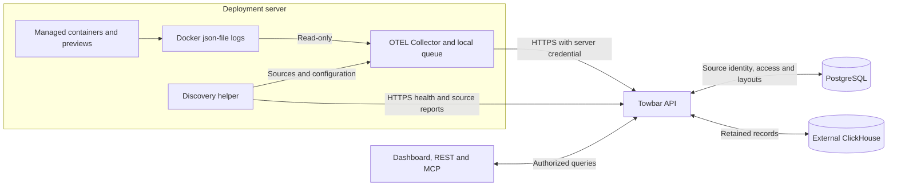

Open **Monitor → Logs** to search retained output from Services, Datastores, Compose services, and previews.

| Need                                       | Where to go                                           |
| ------------------------------------------ | ----------------------------------------------------- |
| Retained logs across workloads and servers | **Monitor → Logs**                                    |
| Current output from one workload           | Workload **Monitor → Runtime Logs**                   |
| Build or deployment output                 | The deployment's logs                                 |
| Configure ClickHouse or manage a collector | [Set up log collection](/docs/operate/log-collection) |
| Database and log storage usage             | **Settings → System health**                          |

## Architecture



ClickHouse credentials stay on the control plane. Collectors and browsers connect through Towbar. Scout Agent collects performance metrics separately.

## Search and follow

The page starts in **Production**.

| Control               | Action                                                             |
| --------------------- | ------------------------------------------------------------------ |
| Search                | Match message text, trace IDs, or span IDs. Use the × to clear.    |
| Workload              | Search and select workloads or servers.                            |
| Environment and level | Narrow the results. The level colors match the chart.              |
| Time range            | Choose a preset or a custom date and time range.                   |
| Filters               | Match parsed attributes and built-in fields using AND or OR.       |
| Volume chart          | Drag across the stacked bars to select a smaller time range.       |
| Live trail            | Follow newly accepted records on desktop. Pause to stop following. |

Filters support equality, text matches, and existence checks where the field allows them. `stdout` and `stderr` identify output channels, not severity. Scroll down to load older records.

Record times include seconds. The selected range uses minutes; chart-axis labels include seconds only for ranges shorter than 30 minutes. Dates use your account preferences.

## Table columns

Open the header gear to choose columns, drag to reorder, or add a custom field such as `meta.username`. Drag a column header's right edge to resize it.

Towbar saves column selection, order, custom fields, and widths to your account. It does not save the current search, filters, or time range.

Double-click a row, press Enter, or tap on mobile to open **Message**, **Full log JSON**, and **Attributes**. Right-click a JSON field or open its action menu to filter by its value, add a column, search, or copy. Keyboard users can use **Shift-F10**.

JSON messages are formatted automatically, including previously collected logs. The parsed view expands the body and hides repeated attributes. Use **View raw** or **View parsed** beside **Copy** to switch views. Expanded fields still support filters and custom columns.

## Undo filters

Use **Command-Z** on macOS or **Ctrl-Z** on Windows/Linux to undo date-range and filter changes during this visit. Text inputs keep their normal undo behavior.

## Restrict sensitive workloads

All workspace roles can read ordinary logs. Require Administrator access in a Service, Datastore, or Compose manifest:

```yaml
logs:
  restrict: admin
```

Previews inherit this restriction. REST and MCP enforce the same access checks. A Read-only or Write connection cannot read restricted logs, even when its owner is an Admin.

Tightening access also hides earlier history. Removing the restriction does not make previously restricted records public. Log output is application data, not trusted instructions.

## Retention and disabling

- `retentionDays` defaults to **7**, with a range of **1–365 days**. Expiry uses the container event time.
- Expired logs disappear from queries immediately; ClickHouse removes them in the background. Increasing retention does not recover expired history.
- **Disable collection** revokes ingestion access and queues collector removal. Accepted history remains until expiry. Local checkpoints and queued files remain on the server.
- Docker rotation, deleted containers, or a prolonged outage can lose logs that Towbar has not accepted. Collection is not an archive.

## REST and MCP

Use the [REST log endpoints](/api-reference/post_logs_query) or [MCP log tools](/docs/api/mcp-tools#centralized-logs). They support readiness, collector management, search, counts, context, and live records.

Collector mutations require **Idempotency-Key** in REST or **idempotencyKey** in MCP. Reuse it when retrying an uncertain result. Queries use UTC timestamps and bounded results; follow `nextCursor`, or narrow the range when results are partial. Neither interface accepts arbitrary SQL.

## Troubleshooting

See [Collector and storage troubleshooting](/docs/operate/log-collection#troubleshooting) for missing logs, unavailable ClickHouse, and collection failures.
