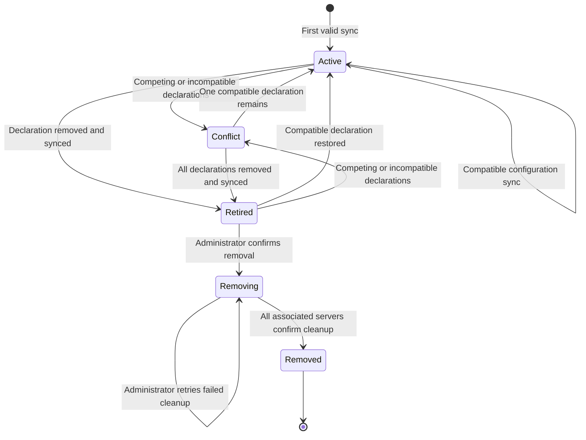
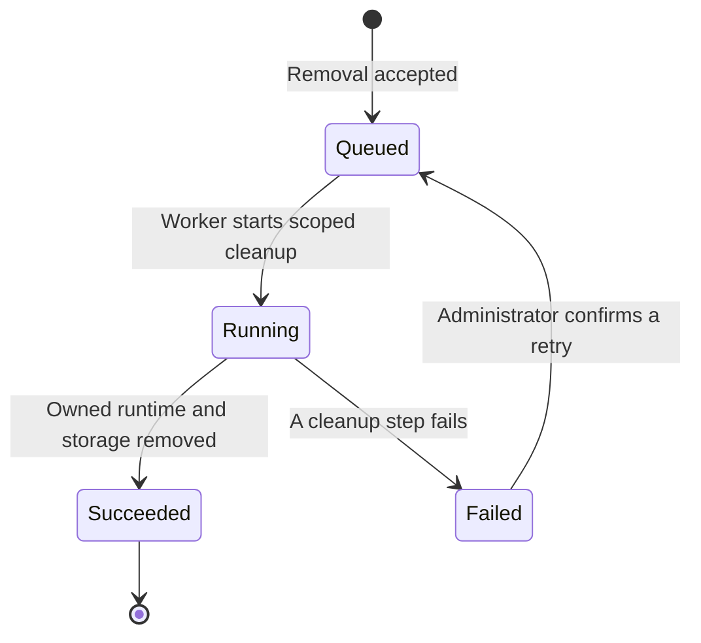
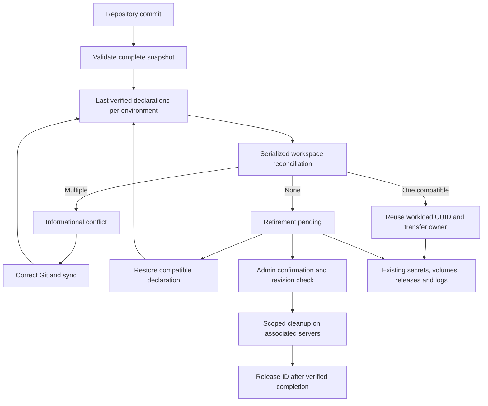

import { Screenshot } from "/snippets/oss/screenshot.jsx";

A manifest ID identifies one workload within a workspace and environment. Use distinct IDs for independent workloads, such as `posted-postgres` and `rootset-postgres`. The same ID in `production` and `staging` identifies separate instances.

Open **Conflicts** or **Retirements**, below **Overview** in the sidebar, to review competing declarations and missing manifests.

| Verified declarations      | Result                                          |
| -------------------------- | ----------------------------------------------- |
| One compatible declaration | That repository manages the existing workload.  |
| Multiple declarations      | Conflict; the current workload stays unchanged. |
| No declaration             | Retirement pending; runtime and data remain.    |

Failed fetches, invalid YAML and incomplete repository trees preserve the last successful declaration. A disconnected repository keeps its last verified claims until it can sync again.

## Service and datastore lifecycle

Services, Compose workloads and Datastores share the same manifest lifecycle. It is separate from runtime health: an **Active** workload can be stopped or unhealthy, and a **Retirement pending** workload can still be running.

1. **Declare and sync:** Git creates the workload's identity and desired configuration.
2. **Deploy:** Towbar builds or pulls the image, runs health checks and promotes a release. Later deployments and rollbacks keep the same workload UUID.
3. **Move or restore:** One compatible declaration can reuse that UUID in another repository, preserving secrets, storage and history.
4. **Retire:** Removing the declaration and syncing preserves the runtime and data for review.
5. **Remove:** An administrator confirms permanent cleanup. Reusing the manifest ID afterward creates a new UUID and fresh storage.

**Conflict** blocks new manifest-managed deployments. It does not stop existing containers. **Removing** cannot be rescued by restoring a manifest; wait for cleanup results before reusing the ID. A conflict can also exist before any workload is created.

## Move between repositories

Keep the manifest ID, environment name and workload type. Either Git order works:

- Add the destination first: sync it to see a conflict, remove the original declaration, then sync the original repository.
- Remove the original first: sync it to see a retirement, add the destination declaration, then sync the destination.

Once exactly one compatible declaration remains, Towbar transfers ownership using the existing workload UUID. Secrets, volumes, domains and deployment history stay attached. Historical deployments retain their original repository provenance. The transfer itself does not restart containers; configuration changes follow the destination's existing deployment settings and storage checks.

The Conflicts page has no resolution actions. Its details show repositories, branches, manifest paths and changed configuration paths. Fix Git, then sync each affected repository. Values are omitted from the diff to avoid exposing credentials embedded in configuration.

<Screenshot
  light="/assets/release-v2/manifest-conflicts-light.jpg"
  dark="/assets/release-v2/manifest-conflicts-dark.jpg"
  alt="The Conflicts table lists competing manifest IDs, workloads, repositories and status."
  width="3200"
  height="1800"
  caption="Conflicts are informational. Correct the declarations in Git."
/>

<Screenshot
  light="/assets/release-v2/manifest-conflict-details-light.jpg"
  dark="/assets/release-v2/manifest-conflict-details-dark.jpg"
  alt="Conflict details show the current workload, repository branches, manifest files and configuration paths that differ."
  width="3200"
  height="1800"
  caption="Details identify the current owner and changes without exposing configuration values."
/>

Changing workload type, moving datastore or Compose storage to another server, or changing a datastore image during a transfer blocks adoption. Complete the relevant migration or upgrade first. Active operations also block transfer; sync again after they finish.

Existing duplicate workloads are preserved on upgrade. A record proven to have been archived before lifecycle tracking can appear as a separate retirement when one compatible declaration already owns a unique current workload. Its data stays intact until explicit removal. Competing declarations and other duplicate workloads remain conflicts; Towbar never merges their data. Storage deleted by earlier cleanup cannot be recovered.

## Permanently remove a retirement

Admins can select **Remove**, type the exact manifest ID and give a reason. This queues cleanup on every associated runtime and build server:

- Removes owned containers, routes, configuration and persistent volumes.
- Preserves deployment history and backups.
- Reserves the ID until all cleanup operations report successful retirement.

<Screenshot
  light="/assets/release-v2/manifest-retirements-light.jpg"
  dark="/assets/release-v2/manifest-retirements-dark.jpg"
  alt="The Retirements table shows a missing manifest with Details and Remove actions."
  width="3200"
  height="1800"
  caption="Restore the manifest to keep this workload, or explicitly confirm removal."
/>

A declaration restored for the retiring workload before removal is requested blocks removal. An unrelated current workload with the same manifest ID does not block removal of a separately identified legacy retirement. Once removal is queued or running, inspect its result before reusing the ID; do not rely on a new manifest to cancel a destructive operation. Failed removal stays visible for inspection and retry. After completion, reusing the ID creates a fresh workload and fresh storage.

### Cleanup progress

A removal may create operations on several runtime and build servers. The workload stays **Removing** until every associated operation confirms cleanup. **Removal failed** keeps the workload visible; open **Details** to inspect errors and retry. Completed retirement records retain history but leave the Retirements table.

The page and sidebar refresh every 3 seconds while cleanup is queued or running, and every 30 seconds otherwise. An accepted request immediately shows **Removing**. Open details track the latest operation state. Polling pauses in hidden tabs and refreshes when you return.

To retain data, restore a compatible manifest instead. To stop the runtime without deleting storage, open the existing workload and use its runtime controls.

## Architecture

## REST and MCP

`GET /v1/core/manifest-lifecycle` lists both pages. Optional parameters: `tab=conflicts|retirements`, `search`, `offset` and `limit`. All workspace members with workload read access can inspect it.

`POST /v1/core/retirements/{workloadId}/actions/remove` requires administrator permission, an `Idempotency-Key`, and a body containing `expectedRevision`, `confirmManifestId` and `reason`. Inspect every returned operation using the existing resource-operation endpoint. Repeat an uncertain request with the same key.

MCP exposes `towbar_manifest_lifecycle_list` and `towbar_retirement_remove` with the same authorization and confirmation rules. There is no conflict-resolution mutation in REST or MCP.
