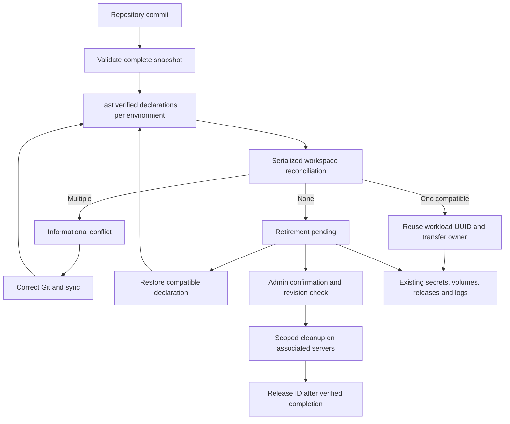

A manifest ID identifies one workload within a workspace and environment. Use distinct IDs for independent workloads, such as `posted-postgres` and `rootset-postgres`. The same ID in `production` and `staging` identifies separate instances.

Open **Conflicts** or **Retirements**, below **Overview** in the sidebar, to review competing declarations and missing manifests.

| Verified declarations      | Result                                          |
| -------------------------- | ----------------------------------------------- |
| One compatible declaration | That repository manages the existing workload.  |
| Multiple declarations      | Conflict; the current workload stays unchanged. |
| No declaration             | Retirement pending; runtime and data remain.    |

Failed fetches, invalid YAML and incomplete repository trees preserve the last successful declaration. A disconnected repository keeps its last verified claims until it can sync again.

## Move between repositories

Keep the manifest ID, environment name and workload type. Either Git order works:

- Add the destination first: sync it to see a conflict, remove the original declaration, then sync the original repository.
- Remove the original first: sync it to see a retirement, add the destination declaration, then sync the destination.

Once exactly one compatible declaration remains, Towbar transfers ownership using the existing workload UUID. Secrets, volumes, domains and deployment history stay attached. Historical deployments retain their original repository provenance. The transfer itself does not restart containers; configuration changes follow the destination's existing deployment settings and storage checks.

The Conflicts page has no resolution actions. Its details show repositories, Git revisions and changed configuration paths. Fix Git, then sync each affected repository. Values are omitted from the diff to avoid exposing credentials embedded in configuration.

Changing workload type, moving datastore or Compose storage to another server, or changing a datastore image during a transfer blocks adoption. Complete the relevant migration or upgrade first. Active operations also block transfer; sync again after they finish.

Existing duplicate workloads are preserved on upgrade. Storage deleted by earlier cleanup cannot be recovered by this migration. Towbar never merges their data or chooses a winner. Give independent workloads distinct IDs in Git and review the old records before retiring them.

## Permanently remove a retirement

Admins can select **Remove**, type the exact manifest ID and give a reason. This queues cleanup on every associated runtime and build server:

- Removes owned containers, routes, configuration and persistent volumes.
- Preserves deployment history and backups.
- Reserves the ID until all cleanup operations report successful retirement.

A declaration restored before removal is requested blocks removal. Once removal is queued or running, inspect its result before reusing the ID; do not rely on a new manifest to cancel a destructive operation. Failed removal stays visible for inspection and retry. After completion, reusing the ID creates a fresh workload and fresh storage.

To retain data, restore a compatible manifest instead. To stop the runtime without deleting storage, open the existing workload and use its runtime controls.

## Architecture

## REST and MCP

`GET /v1/core/manifest-lifecycle` lists both pages. Optional parameters: `tab=conflicts|retirements`, `search`, `offset` and `limit`. All workspace members with workload read access can inspect it.

`POST /v1/core/retirements/{workloadId}/actions/remove` requires administrator permission, an `Idempotency-Key`, and a body containing `expectedRevision`, `confirmManifestId` and `reason`. Inspect every returned operation using the existing resource-operation endpoint. Repeat an uncertain request with the same key.

MCP exposes `towbar_manifest_lifecycle_list` and `towbar_retirement_remove` with the same authorization and confirmation rules. There is no conflict-resolution mutation in REST or MCP.
