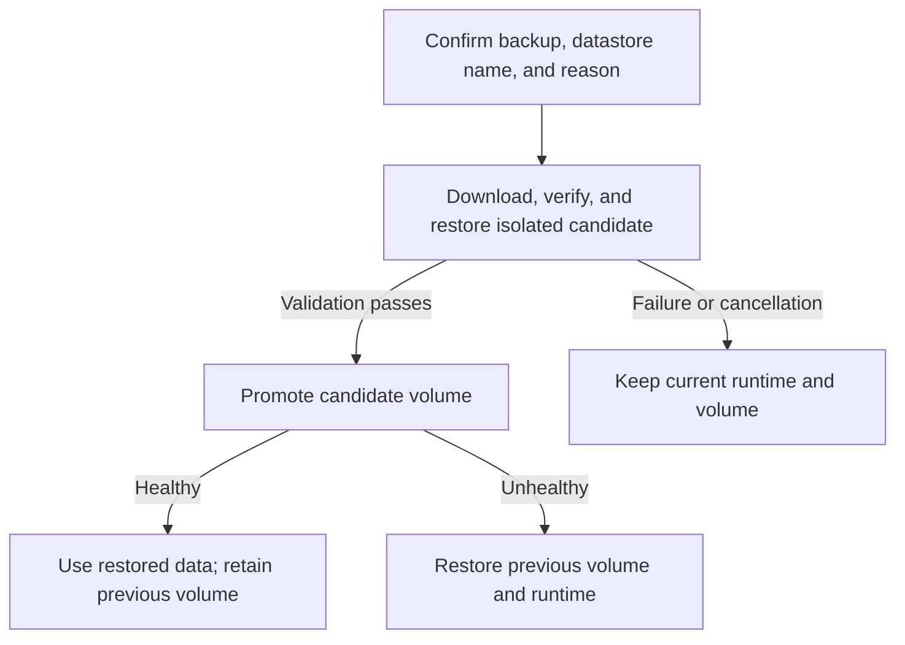

Towbar supports manual restores with validation and rollback protection for manifest-managed PostgreSQL, MySQL, MariaDB, MongoDB, Redis, Dragonfly, KeyDB, and ClickHouse datastores. Retained backups may use an enabled AWS S3, Cloudflare R2, generic S3-compatible, or Google Cloud Storage (GCS) runtime integration. Restores are never started automatically.

## Choose a backup

Open **Datastore → Settings → Restore**. Inspect the retained recovery point's provider, object location, engine, size, and restore-readiness. Keep its original provider enabled even if newer backups use a different destination.

## Before a restore

A retained backup must be marked restore-ready on the Datastore's **Restore** page. Towbar continuously checks every retained object for:

- freshness relative to the declared backup schedule;
- object existence and plausible size across the authoritative storage provider;
- matching SHA-256 checksum metadata;
- declared encryption (AES-256 or AWS KMS for S3; Google-managed or CMEK for GCS);
- matching database engine and major version; and
- the engine-specific archive format (`pg_restore`, SQL, MongoDB archive, engine-specific RDB, or ClickHouse native backup).

Freshness reports whether the latest scheduled recovery point meets its recovery-point objective (RPO); it does not invalidate an older retained backup whose object and compatibility checks still pass. The UI can show an older recovery point as **Stale** while still permitting an explicit, safety-gated restore.

### Provider credential permissions

The runtime provider identity needs read access to the declared backup storage:

- **AWS S3, Cloudflare R2, and generic S3-compatible storage**: object read access on the declared bucket and prefix, including the retained object version where supported. AWS KMS backups also need decrypt access to the selected key.
- **Google Cloud**: `storage.objects.get` on the bucket and prefix. For CMEK, the bucket's Cloud Storage service agent also needs access to the encryption key; see [Google Cloud setup](/docs/integrations/gcp).

The target server must be prepared, have a healthy current datastore release, use one Towbar-owned database volume, and have free Docker storage of at least three times the backup size (with a 1 GiB minimum). Datastores with `container.configFiles` or an entrypoint override need engine-native recovery; managed restore rejects these configurations.

A restorable backup still needs configured provider credentials before Restore is available.

## Restore flow

1. Open **Datastore → Settings → Restore**.
2. Select a restore-ready retained backup from the table and choose **Restore**.
3. In the confirmation dialog, enter an operator reason (at least 10 characters) and type the Datastore name exactly.
4. Towbar serializes the restore operation with active deployments, backups, cleanups, and other work on the target Server.
5. Towbar downloads the backup object from the authoritative provider, verifies checksum and version metadata, creates an isolated candidate volume and container, restores the archive, and validates database readability and health.
6. Only after validation does Towbar atomically switch the stable active-volume pointer and recreate the managed runtime.
7. If promotion health fails, Towbar attempts to switch back to the previous volume and reports **Rolled back** when recovery succeeds. If that rollback also fails, the operation reports the failure and requires operator intervention. Towbar never deletes the previous volume during promotion.

Cancellation is available while work is queued, downloading, verifying, or restoring the candidate. Once volume promotion starts, Towbar must complete promotion or rollback, and the operation cannot be cancelled.

## Rollback retention and cleanup

After a successful promotion, the previous volume is retained for seven days. An Admin can remove it early from the restore history table. The maintenance sweep queues automated cleanup after the retention deadline. Cleanup rechecks Towbar ownership labels and the active-volume pointer; an active, unowned, or missing volume is skipped rather than removed.

## Audit and incident review

The restore history records the actor, operator reason, backup ID and metadata, redacted phase commands, validation results, promotion or rollback outcome, and cleanup status. Secret values and restored data are never written to the audit trail. Restore, rollback, cancellation, and non-restorable backup transitions also dispatch notifications through configured channels.

If a restore fails, review the final phase and error message before retrying. Correct any missing object, incompatible engine version, insufficient disk, credential scope, or runtime health problem first. A candidate failure leaves the active runtime and volume untouched.

## Verify recovery

After the restore reaches its final state, check the datastore's runtime health and connect with an application or database client to verify the expected recovery point. Review the retained previous volume and its cleanup deadline. Record the outcome in your recovery procedure before resuming normal writes or dependent operations.

Restores accept only the same engine and reviewed major version recorded by the backup. Towbar does not use restore as an automatic database upgrade or as a cross-engine conversion path. See the [managed database compatibility matrix](/docs/databases) for the supported versions and native tools.

For storage configuration and schedules, see [Workload backups](/docs/backups). For unavailable objects or credentials, see [Troubleshooting](/docs/troubleshooting#backup-and-restore-problems).
