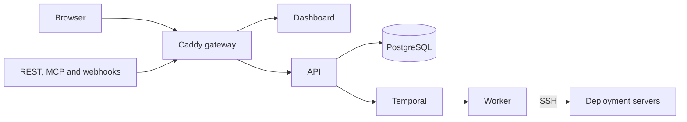

Towbar's host installer runs a Docker Compose control plane on Ubuntu or Debian. It installs Docker when needed, downloads a verified release, generates unique installation secrets, and starts the matching API, worker, and dashboard images by immutable digest. Register deployment servers after installing the control plane.

| Component           | Purpose                                                                    |
| ------------------- | -------------------------------------------------------------------------- |
| Caddy               | Serves the dashboard and API on separate origins; handles public HTTPS.    |
| Dashboard and API   | Provide the browser UI, authorization, REST, MCP, and provider webhooks.   |
| PostgreSQL          | Stores Towbar state, encrypted credentials, and Temporal databases.        |
| Temporal and worker | Coordinate durable workflows and perform operations on deployment servers. |

PostgreSQL and Temporal stay private. The Temporal operator UI binds to loopback on port 8233 and has no Towbar login protection. Access it only through a protected SSH tunnel.

## Choose access for the host installer

<CardGroup cols={2}>
  <Card title="Public HTTPS" icon="globe" href="/docs/self-hosting/installation/public">Use two HTTPS origins for your team, provider webhooks, REST, and MCP.</Card>
  <Card title="Local access" icon="monitor" href="/docs/self-hosting/installation/local">Use loopback dashboard and API ports on the host. External automation is disabled.</Card>
</CardGroup>

Both modes use the same host installer and Compose stack. The repository's source Compose workflow is for development; see [CONTRIBUTING.md](https://github.com/avgeek-oss/towbar/blob/main/CONTRIBUTING.md).

## Files on the control-plane host

<Tree>
  <Tree.Folder name="/etc/towbar" defaultOpen>
    <Tree.File name="config.yml" />
    <Tree.File name="towbar.env (generated)" />
  </Tree.Folder>
  <Tree.Folder name="/opt/towbar" defaultOpen>
    <Tree.Folder name="releases" />
    <Tree.File name="current (active release link)" />
    <Tree.File name="VERSION" />
  </Tree.Folder>
  <Tree.File name="/usr/local/bin/towbar" />
</Tree>

Edit the root-owned `config.yml`, validate it, then restart through the CLI. Keep secrets out of Git and leave the generated environment file to the CLI. Persistent databases and certificate state live in Docker volumes outside the release directories.

After installation, review [Configuration](/docs/self-hosting/configuration), establish [backups](/docs/self-hosting/backup), and read the [upgrade procedure](/docs/self-hosting/upgrades).
