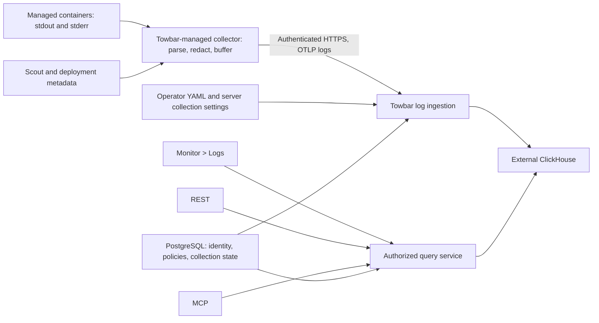

# Centralized logs with external ClickHouse

Status: implementation in progress on the branch below. The worktree contains the
collector, storage contracts, ingestion/query services, REST/MCP operations, and
workspace/server UI. Backend and collector integration checks are running against
isolated local test services. Browser verification and final repository gates are
still pending. No package publication or production deployment has been made.

- Branch: `feat/centralized-logs`.
- Starting commit: `8c73afd3d942b392ae7c610b7638a8b2abec6040` from freshly fetched
  `origin/main` (Towbar 2.0.44, PR #297).
- Artwork: [ClickHouse mascot proposal](../design/proposals/towbar-clickhouse-empty-state.png).
- Provenance: [image generation prompt](../design/proposals/towbar-clickhouse-empty-state.prompt.txt).

## Outcome and agreed scope

An operator configures an external ClickHouse endpoint in Towbar's root-owned
`/etc/towbar/config.yml`, enables log collection on each server, and reads retained
container logs in workspace **Monitor > Logs**. REST and MCP use the same query
service and permissions as the UI.

The first release includes:

- Continuous stdout/stderr collection from supported managed application,
  datastore, Compose, and preview containers.
- A Towbar-managed OpenTelemetry Collector installed from the server page.
- External ClickHouse storage, configured only through operator YAML.
- YAML-controlled retention and observable collection failures.
- A workspace log explorer using Glide Data Grid.
- Historical search, surrounding context, summaries, and live following.
- Log reading for all authenticated workspace roles by default.
- Optional `logs.restrict: admin` on service/datastore manifests, inherited by
  previews and enforced by the backend.
- The current pull-logs operation retained under the name **Runtime Logs**.

Distributed traces, general application OTLP ingestion, profiles, frontend error
tracking, arbitrary host-file collection, and log-query alerts are later work.
Keep existing Scout metrics, analytics, incidents, and deployment logs independent.

## Current implementation to extend

These paths exist at the starting commit. Recheck them before editing if main has
advanced:

| Area                      | Existing integration points                                               |
| ------------------------- | ------------------------------------------------------------------------- |
| Scout collection          | `apps/towbar-monitoring-agent/`                                           |
| Scout lifecycle           | `apps/towbar-api/src/areas/monitoring/lifecycle.ts`                       |
| Monitoring ingest         | `apps/towbar-api/src/routes/v1/monitoring.ts`                             |
| Host-log admission        | `apps/towbar-api/src/areas/apps/host-log-collection.ts`                   |
| Read-only host-log mounts | `packages/towbar-deployer/src/host-log-collection.ts`                     |
| Runtime log capture       | `packages/towbar-deployer/src/resource-operations.ts`                     |
| Contracts and manifests   | `packages/towbar-contracts/src/`, `packages/towbar-core/src/manifest*.ts` |
| Access policy             | `packages/towbar-access/src/index.ts`                                     |
| REST catalogue and MCP    | `apps/towbar-api/src/areas/external-api/`                                 |
| Operator YAML             | `infra/runtime_config.py`, `infra/towbar-cli/15-config.sh`                |
| Configuration checks      | `tools/check-runtime-config.py`, `tools/test-runtime-config.py`           |
| Server UI                 | `apps/towbar-web-app/src/components/server-log-collection.tsx`            |

Scout currently sends compact metrics/analytics snapshots. Its 10 MiB, one-hour
retry buffer is not the application log queue. The existing host-log capability
mounts Docker's container directory read-only for trusted collectors and supports
the `json-file` driver. Current Runtime Logs are bounded Docker tail operations.

## Architecture



Keep ClickHouse credentials on Towbar's control plane. Collectors receive only
their own revocable ingestion identity and collection configuration. They do not
connect directly to ClickHouse.

Use PostgreSQL for server collection settings, credential generations, retained
source/policy metadata, lifecycle operation state, and schema migration state.
Log bodies and persistent log queues do not belong in PostgreSQL or Temporal
workflow/activity payloads. YAML remains the only editable source of storage
configuration and retention.

## Operator configuration

Proposed schema addition, not a currently supported configuration:

```yaml
observability:
  logs:
    retentionDays: 7
    clickhouse:
      endpoint: https://clickhouse.example.com:8443
      database: towbar_logs
      username: towbar
      password: "<your-clickhouse-password>"
```

- Omitting `observability.logs` disables centralized logging. Do not require a
  second `enabled` flag.
- Require a complete ClickHouse block when supplied. Validate identifiers,
  endpoint syntax, and a bounded positive retention value.
- Default retention to seven days. Apply the configured policy to production and
  previews; do not introduce a separate preview toggle or retention setting.
- Follow existing operator-config handling for secrets and generated runtime
  environment. Do not introduce a parallel editable `.env` contract.
- Do not expose passwords through APIs, MCP, diagnostics, or rendered UI.
- Do not provision or own ClickHouse as part of enabling this feature. A
  Towbar-managed datastore can be used if the operator supplies its endpoint, but
  centralized logging does not manage that datastore's lifecycle.

Apply changes through the existing workflow:

```bash
sudo towbar config validate
sudo towbar restart
sudo towbar doctor
```

Syntax errors fail validation before replacement. Optional backend connectivity
or permission failures disable logging and produce actionable diagnostics; they
must not make the API, deployment worker, or existing monitoring unavailable.
Separate configuration validation from remote logging readiness checks.

Removing configuration stops export and reconciles installed centralized-log
collectors to disabled. It does not drop the external database. A temporary
backend outage instead uses the bounded local queues and reports a backlog.

## Collector installation and lifecycle

Add **Log collection** beside Scout on the server page. An administrator can
install/enable, update, inspect, or disable it there. Enable installation once the
configured backend passes verification.

Towbar performs installation through its existing trusted SSH/deployer workflow.
Use a tested collector image pinned by digest in the Towbar release. Users do not
choose arbitrary collector images or install host packages manually.

Run one dedicated collector container per enabled server with:

- Read-only access through the existing fixed host-log mount capability.
- No Docker socket, arbitrary host mounts, or ClickHouse credentials.
- A persistent volume for file checkpoints and the exporter queue.
- Separate resource limits and diagnostics from Scout.
- A revocable, server-scoped upload credential and configuration generation.
- An exclusive owner for checkpoint/queue state. Stop the old collector before
  starting a replacement against the same state.
- Collector self-logs excluded from collection to avoid recursion.

Extend trusted discovery to provide eligible container IDs, paths, source and
deployment identities, environment, preview identity, and Compose service names.
Validate ownership again at ingestion. Container messages cannot set trusted
workspace or workload labels.

Preview containers are collected automatically on enabled servers. They inherit
the parent workload's visibility policy. Removing a preview or container must not
delete its accepted history or the metadata needed to authorize buffered records.

The initial file-based source supports Docker `json-file`. Report other drivers
as unsupported with affected container counts. Offer an explicit configuration
and redeploy path; do not change logging drivers on existing containers silently.
The existing collector admission restriction against preview deployments remains
valid: the server collector reads preview logs, and is not itself a preview app.

Collection begins when enabled. Existing containers start at their current
position; newly discovered containers are read from their beginning. Checkpoints
take precedence on restart. Historical backfill is outside the initial release.
Coordinate runtime cleanup with a bounded drain attempt. Data removed before the
collector reads it cannot be reconstructed and must not be described as retained.

Disabling collection revokes export access, stops its managed collector, and
preserves accepted history. Define queue retention on disable/re-enable and
uninstall explicitly; never replay past configured expiry. Do not claim this
stops independently deployed external collectors that use the older host-log
capability.

## Parsing and bounded delivery

Decode the Docker envelope, preserving its timestamp, stream, and message. Parse
common JSON message/severity fields while retaining structured attributes. Keep
plain text when JSON parsing is unavailable. Stderr alone does not imply Error;
use Unknown when severity is absent.

Preserve structured stack traces. Provide bounded multiline parsing only as an
explicit workload parser option after checking its manifest shape. Do not guess
message boundaries across unrelated events. Treat log text as plain untrusted
content, including ANSI/control sequences and HTML-like payloads.

Proposed starting budgets, to be measured before release:

| Budget                      | Initial proposal                                  |
| --------------------------- | ------------------------------------------------- |
| Persistent queue per server | 512 MiB                                           |
| Maximum queued age          | 24 hours, also limited by configured retention    |
| Export cadence              | Approximately one second plus size-based batching |
| Maximum normalized record   | 256 KiB, with explicit truncation metadata        |

Set limits for decompressed requests, batch size, concurrent files, attributes,
ingestion rate, CPU, and memory after the collector proof. Enforce the disk budget
against actual storage use, not only the number of queued requests. Apply
redaction before persistent queueing and repeat required validation at ingestion.

Use at-least-once delivery. Persist file offsets and the exporter queue; enable
downstream retry behavior explicitly. Backpressure pauses reading. Report queue
exhaustion, rejection, expiry, and observed source gaps. Do not label a collector
healthy solely because its process is running.

Stable event identity is a first-milestone gate. Verify that the selected pinned
receiver exposes enough source identity, file generation, and record position to
retain IDs through rotation and replay. Add a small source adapter only if needed.
Hashing message contents alone is not sufficient because repeated messages can
be distinct events. Keep identity independent of redaction changes and retry time.

The ingestion endpoint accepts collector-authenticated OTLP/HTTP logs, validates
the current credential and server/source mapping, and waits for confirmed
ClickHouse acceptance before acknowledging export. Do not acknowledge an
unpersisted in-memory batch. Return bounded, retryable failures during outages.
General application OTLP endpoints and traces are later work.

## ClickHouse schema, migration, and retention

Use a dedicated database with a versioned, serialized schema migration process.
Document required database preparation and scoped SELECT/INSERT/schema privileges.
Keep bootstrap privileges separate from steady-state credentials where operators
choose that setup. Do not require account-wide database administration.

Verify endpoint reachability, TLS, authentication, database presence, supported
features, schema compatibility, migration privileges, a test insert, and a query
of that insert. Report which step failed. Normal API startup must not repeatedly
attempt unbounded DDL or depend on logging availability.

Proposed `log_records` fields:

| Group       | Fields                                                                      |
| ----------- | --------------------------------------------------------------------------- |
| Ownership   | `workspace_id`, `server_id`, `workload_id`, `deployment_id`, `container_id` |
| Identity    | Stable `event_id`, source/file identity required for replay                 |
| Source      | `environment`, `preview_id`, `compose_service`, `stream`                    |
| Time        | Docker/event `timestamp`, `observed_at`, `ingested_at`, `expires_at`        |
| Content     | `severity_number`, `severity_text`, `body`, bounded structured attributes   |
| Correlation | Optional `trace_id`, `span_id`                                              |
| Policy      | Trusted `visibility` value of `all` or `admin`                              |
| Processing  | Schema version and parsing/truncation indicators                            |

Store times in UTC with sufficient precision for Docker records. Validate future
timestamps and preserve trustworthy source time for expiry and ordering.

Start with daily partitions and a sort key for workspace/workload/time queries.
Benchmark the actual cross-workload search shape before fixing indexes. Support
bounded message search and typed attribute filters using features available in
the tested ClickHouse version.

Use retry deduplication in storage and at query time. If selecting
`ReplacingMergeTree`, do not rely on background merges to produce correct lists
or counts. Benchmark query-time deduplication under realistic retained volumes.
Do not claim exactly-once delivery.

Expired records disappear from queries immediately; physical removal follows TTL
processing. Shorter retention takes effect in queries before asynchronous cleanup.
An increase never resurrects expired records. Preserve accepted history across
container deletion, redeployment, and workload removal until expiry. Retain the
minimum policy/source metadata needed to authorize those records. Disconnecting
ClickHouse does not automatically drop its database, tables, or backups.

## Manifest restrictions and access

All authenticated workspace roles can read unrestricted logs. Include this in
the Read-only and Write API/MCP access levels. No anonymous access is introduced.

Add this proposed optional block to service and datastore manifests, and to the
corresponding Compose workload policy:

```yaml
logs:
  restrict: admin
```

Omission means workspace-visible logs. `restrict` controls reading, not whether
the collector ingests the record. Carry the policy through normalized manifests,
deployment snapshots, rollback, preview inheritance, and API contracts.

| Effective reader                      | Unrestricted records | Admin-restricted records     |
| ------------------------------------- | -------------------- | ---------------------------- |
| Viewer or Member browser session      | Yes                  | No                           |
| Admin browser session                 | Yes                  | Yes                          |
| Read-only or Write API/MCP connection | Yes                  | No                           |
| Administrator API/MCP connection      | Yes                  | Within current authorization |

Separate ordinary log reading from restricted-log permission. Evaluate both the
current workspace role and the granted API/MCP access ceiling. A personal token
must not regain admin access after its owner is downgraded. Team keys must carry
an explicit permitted administrator grant. Preserve the existing role-change
revocation behavior and test it.

Stamp visibility from trusted control-plane metadata during ingestion, never from
message attributes or untrusted preview input. Enforce workspace and effective
visibility before rows, aggregation, facets, surrounding context, copying/export,
and live-tail results leave the backend. This is not a client-side filter.

Adding a restriction protects existing history immediately. Stored admin labels
remain restrictive if the manifest later omits the block. Relaxing a policy needs
administrator authorization; previews and ordinary manifest writers cannot
declassify history. General historical declassification is outside the first
release. Retain policies for deleted sources and restrict records whose policy
cannot be resolved rather than exposing them. Recheck active streams and caches
when authorization or policy changes.

## Monitor UI

Add only workspace **Monitor > Logs** for centralized searching. Rename existing
workload Logs navigation and headings to **Runtime Logs** without changing the
pull-logs behavior. Workload and deployment links may open the workspace explorer
with filters already selected.

Use Glide Data Grid through a shared design-system adapter. Keep search, filters,
buttons, status components, and record detail dialogs on shared primitives.

- Read-only, resizable columns for Time, Level, Workload, and Message.
- Compact rows. Full multiline content and attributes open in a detail dialog.
- Backend search and cursor-based result windows; no download of all history.
- Selection/copying and keyboard navigation, with editing and paste disabled.
- Theme tokens for canvas rendering in light/dark modes.
- Horizontal scrolling on mobile, accessible controls, and a bounded grid cache.
- Time-range, workload, server, deployment, environment/preview, severity, stream,
  message, and bounded structured-field filters.
- A compact volume timeline, Follow/Pause, and new-record notification while paused.
- Account timezone for display; UTC retained for storage and exact timestamps.

Configure Next.js client loading, the grid's portal integration, viewport sizing,
and accessible DOM support. Verify touch, screen-reader, selection/copy, and
dialog focus behavior on real rendered routes. Search must cover server history,
not just loaded grid cells. Preserve filter state during refreshes.

Use the supplied transparent mascot for both unconfigured and storage-error
states, with the specific message beside it:

| State                                        | Copy or behavior                                                                   |
| -------------------------------------------- | ---------------------------------------------------------------------------------- |
| YAML absent                                  | Connect ClickHouse to enable log collection. Link to setup documentation.          |
| Network/DNS/TLS failure                      | Couldn't connect to ClickHouse. Show a sanitized reason and troubleshooting guide. |
| Credentials/permissions/schema error         | Name the failed requirement and link to requirements documentation.                |
| Storage ready, no collector                  | Enable log collection on a server. Link to Servers.                                |
| Waiting for first record                     | Report installed/collecting status without claiming verified ingestion.            |
| No search matches                            | Ordinary empty result, preserving current filters.                                 |
| Backlog, offline collector, partial coverage | Visible diagnostics with affected servers and supported/unsupported counts.        |

There is no editable ClickHouse connection or retention form in the UI. Show
sanitized readiness and effective retention. Do not expose configuration secrets.
Treat the copied illustration as a proposal; do not overwrite the Sketch source
or other mascot assets during implementation.

## REST and MCP

Register shared contracts in Towbar's core operation catalogue and regenerate
OpenAPI, response schemas, clients, Postman collections, and reference docs.
Suggested routes are proposals, not existing endpoints:

| REST operation                                                  | Purpose                                             |
| --------------------------------------------------------------- | --------------------------------------------------- |
| `GET /v1/core/observability/logs/status`                        | Effective non-secret settings and storage readiness |
| `POST /v1/core/observability/logs/actions/verify`               | Administrator-triggered write/query verification    |
| `GET /v1/core/servers/:serverId/log-collection`                 | Lifecycle, coverage, queue, and diagnostics         |
| `PUT /v1/core/servers/:serverId/log-collection`                 | Administrator enables or disables collection        |
| `POST /v1/core/servers/:serverId/log-collection/actions/update` | Update to the collector bundled with this release   |
| `POST /v1/core/logs/query`                                      | Bounded historical search                           |
| `POST /v1/core/logs/summary`                                    | Filtered timeline and facets                        |
| `POST /v1/core/logs/context`                                    | Authorized records around one event                 |
| `POST /v1/core/logs/tail`                                       | Authenticated resumable stream                      |

No REST or MCP operation writes ClickHouse settings, credentials, or retention;
those remain in YAML. Collector lifecycle mutations use accepted operation IDs,
idempotency keys, and terminal status inspection.

Proposed MCP tools:

- `towbar_logs_inspect` for storage status and collection diagnostics.
- `towbar_logs_query` for a bounded page of records.
- `towbar_logs_summary` for filtered counts and facets.
- `towbar_logs_context` for neighboring records.
- `towbar_logs_collection_configure` for administrator lifecycle actions.
- `towbar_logs_verify` for administrator verification.

Default MCP queries to 50 records with a bounded output-byte budget, opaque
continuation cursors, and explicit truncation/partial-result metadata. Use repeated
bounded queries for MCP following; do not hold an indefinite tool stream.
Describe returned log bodies as untrusted data.

All interfaces call the same query service. Use validated filters, parameterized
SQL, query/memory/time limits, cancellation, and workspace quotas. Do not accept
arbitrary SQL or regex execution. Pin page snapshots and define cursor expiry.
Live follow uses ingestion progress so late-arriving records are not lost solely
because their event timestamps precede the current view. Resume with a bounded
overlap and stable IDs; report gaps when the resume position expires.

## Implementation sequence

1. **Contracts and collector proof.** Add proposed YAML/manifest schemas and
   policy tests. Pin a collector and prove discovery, parsing, persistent offsets,
   queue bounds, rotation, event identity, restart/replay, preview inheritance,
   and resource isolation. Do not finalize storage deduplication before this gate.
2. **ClickHouse and API foundation.** Add optional runtime wiring, versioned schema
   management, readiness, ingestion, authorized queries, deduplication, retention,
   and actionable error contracts. Keep the feature disabled when unconfigured.
3. **Managed server lifecycle.** Implement install/update/disable, exclusive queue
   ownership, credential rotation/revocation, source discovery, drain coordination,
   and collection diagnostics. Exercise AMD64 and ARM64 Docker lifecycles.
4. **Shared grid and Monitor.** Implement the shared Glide adapter and workspace
   explorer, filters, details, timeline, following, empty/error states, and Runtime
   Logs rename. Verify desktop/mobile/keyboard behavior before sign-off.
5. **REST/MCP and operator documentation.** Complete catalogue generation, tool
   annotations, role/grant tests, requirements SQL examples, configuration/restart
   workflow, retention, driver compatibility, queue sizing, and recovery guidance.
6. **Pilot and release readiness.** Run workload-level ingestion verification,
   sustained-load measurements, fault recovery, regression checks, and rollback
   review. Keep any existing logging system available through the recovery window.

These are reviewable delivery units, not a requirement to merge incomplete public
behavior. Package publication, merging, releases, and production deployment are
separate follow-up actions. Do not perform them as part of saving this plan.

## Implementation checkpoint

The implementation is present on `feat/centralized-logs` in the isolated worktree.
Verification uses disposable local PostgreSQL and ClickHouse databases and
synthetic workloads. It is not production cutover evidence.

Verified locally:

- 28 focused API/logging checks across contracts, storage, source attribution,
  lifecycle admission, storage readiness, and REST/OAuth MCP. These cover
  parameterized queries, stable pagination, replay deduplication, context,
  preview/Compose/datastore identity, inherited and sticky restrictions,
  idempotency under concurrent requests, incompatible schema and insufficient
  permissions, irreversible retention cutoffs, Unicode byte limits, skewed
  timestamps, and live key revocation.
- The pinned collector reading a real Docker `json-file` source: masking before
  transmission, 202 records recovered through an API outage and collector restart,
  checkpoint resume, distinct repeated messages, and Docker log rotation.
- A local sustained sample of 1,000 records over ten seconds at 100 records/second,
  with a 0.25-CPU and 256-MiB collector limit. The latest standalone run accepted all
  1,000 records, measured 186 ms p95 ingestion latency, sampled 37.9–39.9 MiB memory
  and 0.66–0.88% Docker CPU, and completed its aggregate query in 6 ms. The sample
  contained 265,890 message bytes. These measurements are a baseline for one
  container, not a supported production capacity claim or full-queue stress test.
- Drain helper identity, ownership, fixed-path validation, final-container stop,
  and acknowledgement checks; Bash syntax checks cover the composed cleanup
  scripts, including background cleanup.
- Desktop/mobile fixture review in light/dark themes: search, pagination, details,
  context, copy, follow/pause, invalid filters, empty storage, and no page overflow.
  The Glide accessibility tree exposes rows/cells and Enter opens details under
  React Strict Mode. Its pinned compatibility patch is documented in
  [patches/README.md](../patches/README.md).
- Ten Python runtime-configuration tests, a frozen-lockfile installation, generated
  API/schema/Postman checks, and the complete `pnpm verify` command, including the
  production web build and production dependency audit.

The required API and Docker regression jobs are being run against the final tree.
Full 512-MiB queue saturation, long-duration multi-server capacity, deployed
collector installation on a real Ubuntu host, and production pilot/rollback
acceptance remain operational sign-off gates before production logging cutover.
The UI evidence above uses local fixtures; it does not establish a deployed
browser session or a production end-to-end log flow.

## Acceptance and sign-off

- [ ] Missing YAML keeps the feature optional and shows the mascot/setup guide.
- [ ] Invalid config, permissions, TLS, and backend outages produce specific safe errors.
- [ ] Logging failure does not stop existing Scout metrics or deployment operations.
- [ ] Production apps, datastores, Compose services, and previews are attributable.
- [ ] Unsupported drivers and source gaps appear as coverage limitations.
- [ ] History survives container replacement, rollback, preview deletion, and workload deletion.
- [ ] Rotation, abrupt restart, export timeout, and replay preserve correct event identity.
- [ ] Distinct repeated messages remain distinct; retry duplicates do not inflate results.
- [ ] Queues obey measured disk/memory limits and show backlog, expiry, and loss.
- [ ] Oversized, malformed, multiline, control-character, and skewed-time records are bounded.
- [ ] Workspace isolation and collector impersonation tests pass.
- [ ] All roles can read unrestricted logs; restricted logs require effective administrator access.
- [ ] Counts, facets, context, copies, REST, MCP, and streams enforce the same restriction.
- [ ] Policy tightening protects history; preview overrides and role downgrades cannot weaken it.
- [ ] Expired data stays hidden even before TTL removal or after retention increases.
- [ ] Live follow resumes with late arrivals, cancellation, and explicit expired-cursor gaps.
- [ ] Glide works in light/dark, desktop/mobile, keyboard, touch, and screen-reader checks.
- [ ] A controlled emitted record is verified through ClickHouse, UI, REST, and MCP.
- [ ] Sustained-load reports record collector overhead, ingestion throughput, storage growth,
      query latency, and the tested supported workload before choosing final budgets.
- [ ] Relevant repository checks and generated-contract checks pass on the final implementation head.
- [ ] Pilot and rollback evidence is recorded before production logging cutover.

## References

- [OpenTelemetry file log receiver](https://github.com/open-telemetry/opentelemetry-collector-contrib/tree/main/receiver/filelogreceiver)
- [OpenTelemetry collector resiliency](https://opentelemetry.io/docs/collector/resiliency/)
- [ClickHouse ReplacingMergeTree and query-time deduplication](https://clickhouse.com/docs/reference/engines/table-engines/mergetree-family/replacingmergetree)
- [Glide Data Grid](https://grid.glideapps.com/)
- [Glide DataEditor API](https://docs.grid.glideapps.com/api/dataeditor)
- [Existing Towbar configuration workflow](../docs/docs/self-hosting/cli/configuration.mdx)
